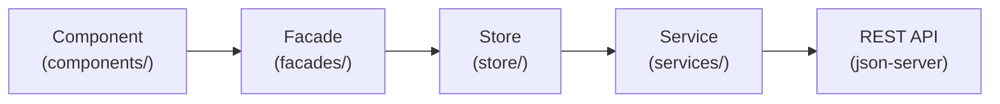

# 4-Tier Code Validation Rules - Student Management

This document defines the comprehensive 4-tier validation framework for all code changes, new features, and refactoring in the Student Management project.

---

## Tier 1: Architecture & Structural Boundaries

All domain features in `src/app/features/<feature>/` strictly adhere to **Option B (Explicit Layering)**:



### Boundary Rules
1. **Component Isolation**:
   - MUST ONLY inject and invoke Facades (e.g. `StudentFacade`, `ClassFacade`, `AuthFacade`), `Router`, and `FormBuilder`.
   - **VIOLATION**: Direct imports from `../services/` or `../store/` inside components.
   - **VIOLATION**: Direct `HttpClient` calls from components.
2. **Facade Decoupling**:
   - Facades coordinate state from Stores and expose read-only signals to Components.
   - **VIOLATION**: Direct injection or usage of `HttpClient` inside Facades.
3. **Store State Management**:
   - SignalStores (`@ngrx/signals`) manage state, loading/error states, and computed projections.
   - Stores invoke HTTP methods on Services via `rxMethod` with appropriate operators (`exhaustMap` for writes, `switchMap` for reads).
4. **Service Cleanliness**:
   - Services contain pure HTTP calls using Angular `HttpClient`.
   - **VIOLATION**: Services importing or depending on Stores, Facades, or Components.
5. **Directory Conformance**:
   - Only allowable top-level directories in `src/app/features/<feature>/`:
     `components`, `facades`, `models`, `services`, `store`, plus `<feature>.routes.ts`.

> Automated validation: `npm run check:arch` (runs `scripts/check-architecture.mjs`).

---

## Tier 2: TypeScript & Angular Technical Standards

### 1. TypeScript Strictness
- **Zero `any` Policy**: Never use `any`. Use strict interfaces, generics, or `unknown` with type guards.
- **DTO Interfaces**: Every entity must define explicit DTOs (`Create<Entity>Dto`, `Update<Entity>Dto`).
- **Relative Imports**: Do not introduce arbitrary path aliases; use clean relative paths.

### 2. Angular 22 & Modern Reactivity
- **Standalone Components**: All components must be `standalone: true`.
- **Signal-First State**: Use Angular Signals (`signal()`, `computed()`) for UI state.
- **Side-Effect-Free Computations**: `computed()` signals must remain pure and deterministic.
- **Dependency Injection**: Use `inject(...)` exclusively rather than constructor parameter injection.

### 3. Reactive Forms
- **Strictly Typed Forms**: Use `FormBuilder.nonNullable.group({...})`.
- **Form Submission**: When form fields are disabled during editing (e.g., entity ID or code), use `form.getRawValue()` instead of `form.value` to prevent dropping key identifiers.

### 4. SSR & Node.js Safety
- Always guard browser globals (`window`, `document`, `sessionStorage`, `localStorage`):
  ```typescript
  if (typeof sessionStorage !== 'undefined') {
    // safe browser execution
  }
  ```

### 5. UI & Styling Standardization
- Catalog list and detail views must import `../../../../shared/styles/catalog.css` (or relative path to `shared/styles/catalog.css`) for consistent button, table, filter, and badge styles.

---

## Tier 3: Domain Business Logic & Integrity Rules

### 1. Identifier Formats & RegEx Validation
- **Class Code**: `/^CLS\d{3,}$/` (e.g., `CLS001`, `CLS101`)
- **Teacher Code**: `/^GV\d{3,}$/` (e.g., `GV001`, `GV002`)
- **Subject Code**: `/^MH\d{3,}$/` (e.g., `MH001`, `MH002`)
- **Academic Year**: `/^\d{4}-\d{4}$/` (e.g., `2025-2026`)
- **Phone Number**: `/^[0-9]{10}$/`
- **Email**: Standard email format via `Validators.email`

### 2. Grades & Academic Scoring
- **Score Range**: Numeric values between `0` and `10` inclusive (`Validators.min(0)`, `Validators.max(10)`).
- **Composite Uniqueness**: Each student can only have one grade record per subject `(studentId, subjectId)`.

### 3. Referential Integrity on Delete
Before deleting entities from mock API:
- **Delete Class**: Verify that no student has `student.classId === class.id` or `student.className === class.name`.
- **Delete Teacher**: Verify that no subject has `subject.teacherId === teacher.id`.
- **Delete Subject**: Verify that no grade record has `grade.subjectId === subject.id`.
- **Delete Student**: Check for associated grade records or handle dependent records.

### 4. Role-Based Access Control (RBAC)
- Guard UI actions using `@if (authFacade.can('permission-name'))`.
- Supported permissions: `manage-students`, `manage-classes`, `manage-academics`, `view-grades`, etc.
- In unit test specs (`.spec.ts`), provide a mock `AuthFacade` with `{ can: () => true }` so permission-gated buttons and forms are properly rendered for testing.

---

## Tier 4: Automated Verification Pipeline

Before completing any task, run the full verification pipeline:

```bash
# Windows command prompt / powershell execution:
cmd /c npm run verify
```

### Verification Pipeline Components:
1. **`npm run check:arch`**:
   - Scans all files in `src/app/features/`.
   - Validates that 0 components import services or store.
   - Validates that 0 facades import `HttpClient`.
   - Validates clean Option B directory structures.
2. **`npm run build`**:
   - Compiles TypeScript with Angular AOT compiler.
   - Validates SSR server build (`src/server.ts`).
   - Ensures no template syntax errors or broken imports.
3. **`npm run test:ci`**:
   - Executes Vitest test suites (`ng test --watch=false`).
   - Verifies 100% test pass rate with 0 unhandled promise rejections.
