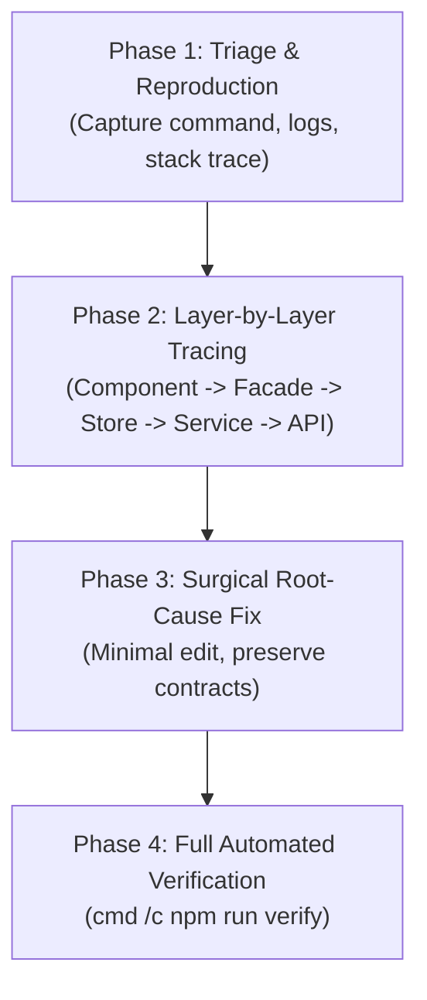

# Debugging Skill — Student Management System

This skill guides systematic diagnostic procedures and issue resolution across all layers of the Student Management application under **Explicit Layering**.

---

## 1. Troubleshooting Philosophy & Rules

1. **Reproduce with Exact Evidence**: Capture the complete error message, stack trace, and exit codes before modifying any files.
2. **Layer-by-Layer Isolation**: Trace bugs along the explicit layer path:
   `Component UI ➔ Facade ➔ SignalStore ➔ Service ➔ REST API`.
3. **Minimal Surgical Edit**: Fix only the root cause. Avoid broad rewrites of functional code outside the bug's scope.
4. **Automated Verification**: Always verify fixes by running the full verification pipeline:
   ```bash
   cmd /c npm run verify
   ```

---

## 2. Quick Troubleshooting Matrix

| Symptom | Likely Layer | Root Cause | Immediate Action |
| :--- | :--- | :--- | :--- |
| **`check:arch` fails** | Architecture Gate | Component directly imports Service or Store; Facade imports `HttpClient`. | Decouple via Facade; remove disallowed imports. |
| **`AssertionError: expected null` in tests** | Template / RBAC | `@if (authFacade.can(...))` hides element in unauthenticated test run. | Provide mock `AuthFacade` returning `can: () => true`. |
| **`ECONNREFUSED :3001` in specs** | Test Bed | Service not mocked in `TestBed`, attempting real HTTP calls. | Mock service with `{ getAll: () => of([]) }`. |
| **`ReferenceError: sessionStorage`** | SSR Prerender | Browser object accessed during Node.js prerender. | Guard with `if (typeof sessionStorage !== 'undefined')`. |
| **Form loses ID on edit submit** | Reactive Form | ID control is disabled and submission reads `form.value`. | Use `form.getRawValue()` instead of `form.value`. |
| **UI does not update after save** | SignalStore | Missing `patchState` in `tap()` or dropped in `exhaustMap`. | Ensure `patchState` is called on HTTP response in `rxMethod`. |
| **PowerShell `PSSecurityException`** | Environment | Windows execution policy blocks `npm.ps1`. | Prefix command with `cmd /c npm ...`. |

---

## 3. The 4-Phase Diagnostic Protocol



### Phase 1: Triage & Reproduction
1. Execute the failing step:
   - For architecture violations: `cmd /c npm run check:arch`
   - For build/SSR errors: `cmd /c npm run build`
   - For test failures: `cmd /c npm run test:ci`
2. Record the exact failure message, file, and line number.

### Phase 2: Layer-by-Layer Tracing
- **UI / Template**: Are bindings, `@if` permissions, and signals emitting expected values?
- **Facade**: Is the facade exposing the correct signals and forwarding calls to Store?
- **Store**: Is `patchState` invoked? Is `rxMethod` handling errors without crashing?
- **Service**: Is the HTTP endpoint correct (`http://localhost:3001/...`)? Is the ID URL-encoded?
- **Mock API**: Is `json-server` running and `db.json` accessible?

### Phase 3: Surgical Root-Cause Fix
- Formulate a testable hypothesis.
- Apply the minimal code modification needed to solve the problem.
- Preserve existing comments, docstrings, and unrelated code.

### Phase 4: Full Automated Verification
Execute the 3-in-1 verification pipeline:
```bash
cmd /c npm run verify
```
Confirm:
- Architecture boundary checks: **PASSED (0 violations)**.
- Angular build & SSR build: **PASSED (0 errors)**.
- Vitest test suite: **PASSED (100% pass rate)**.

---

## 4. Debugging Response Format

When reporting debugging findings to the user or team, provide:
1. **Problem Summary**: Concise description of what failed and under what conditions.
2. **Root Cause Analysis**: The exact file, line number, and mechanical reason for the failure.
3. **Surgical Fix**: The precise code change applied.
4. **Verification Evidence**: Output from `npm run verify` demonstrating green checks.

---

## 5. References

- Detailed troubleshooting patterns: [debugging-guide.md](references/debugging-guide.md)
- 4-Tier validation rules: `.github/skills/code-validation/references/validation-rules.md`
- Architecture boundaries: `.github/skills/project-architecture/references/architecture.md`
