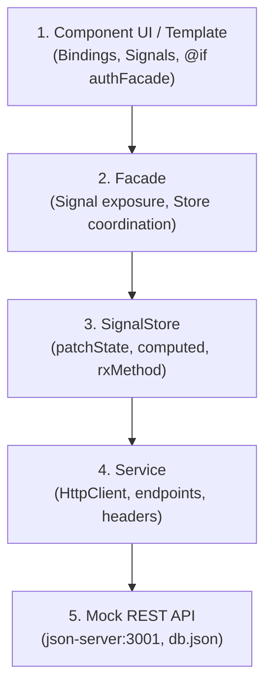

# Debugging Guide Reference - Student Management

This guide provides deep-dive troubleshooting procedures, root-cause analyses, and proven fixes for common failure modes across all layers of the Student Management application under **Explicit Layering**.

---

## 1. Layer-by-Layer Debugging Workflow



---

## 2. Layer 1: Component & Template Issues

### Issue 1.1: Action button (e.g. "Thêm", "Sửa", "Xóa") does not appear
- **Root Cause**: The button is protected by `@if (authFacade.can('...'))` or `@if (authFacade.role() === 'admin')`, and the current session lacks permissions or `sessionStorage` is uninitialized.
- **Diagnostic Step**: Check `authFacade.currentUser()` in console or browser devtools.
- **Fix**: Log in with an account having appropriate role (`admin`, `teacher`), or in unit tests provide a mock `AuthFacade`:
  ```typescript
  { provide: AuthFacade, useValue: { can: () => true, currentUser: signal({ role: 'admin' }) } }
  ```

### Issue 1.2: Edit form submission loses ID/code
- **Root Cause**: When editing an entity, the ID control is disabled (`controls.id.disable()`). Calling `form.value` drops disabled controls.
- **Fix**: Always use `form.getRawValue()` when submitting forms.

### Issue 1.3: Form does not populate when item is selected
- **Root Cause**: The `effect()` in the form constructor fails to track the input signal or runs outside the injection context.
- **Fix**: Ensure the input signal is called inside `effect()`:
  ```typescript
  constructor() {
    effect(() => {
      const item = this.item();
      if (item) {
        this.form.patchValue(item);
      }
    });
  }
  ```

---

## 3. Layer 2: Facades & NgRx SignalStore

### Issue 2.1: UI does not update after saving or deleting
- **Root Cause 1**: `patchState(store, ...)` was not invoked upon successful completion of the HTTP operation.
- **Root Cause 2**: Using `exhaustMap` vs `switchMap`: if an action is fired while another request is active, `exhaustMap` drops subsequent triggers.
- **Fix**: In `rxMethod`, refresh store data or patch state inside `tap()`:
  ```typescript
  saveItem: rxMethod<{ item: Entity; mode: 'add' | 'update' }>(
    pipe(
      tap(() => patchState(store, { loading: true })),
      exhaustMap(({ item, mode }) =>
        (mode === 'add' ? service.create(item) : service.update(item.id, item)).pipe(
          switchMap(() => service.getAll()),
          tap((items) => patchState(store, { items })),
          finalize(() => patchState(store, { loading: false }))
        )
      )
    )
  )
  ```

### Issue 2.2: Infinite loop or Maximum Call Stack Exceeded
- **Root Cause**: Writing to a signal inside an `effect()` that directly or indirectly reads that same signal.
- **Fix**: Use `untracked()` for signals that should not trigger re-execution of the effect.

---

## 4. Layer 3: Services & Mock API (`json-server`)

### Issue 3.1: HTTP 0 / Connection Refused (`ERR_CONNECTION_REFUSED`)
- **Root Cause**: `json-server` is not running on port 3001.
- **Fix**: Start the mock API server:
  ```bash
  cmd /c npx json-server --watch db.json --port 3001
  ```

### Issue 3.2: Generated Hash IDs (`"R2J5VkW"`)
- **Root Cause**: `json-server` generates random string IDs if the payload contains an existing ID or when POSTing without an ID.
- **Fix**: When querying or matching entities, always support both:
  ```typescript
  entity.id === targetId || entity.code === targetId
  ```

### Issue 3.3: HTTP 404 on Update or Delete
- **Root Cause**: Missing URI encoding for IDs containing slashes or special characters.
- **Fix**: Use `${this.apiUrl}/${encodeURIComponent(id)}`.

---

## 5. Layer 4: SSR & Hydration Safety

### Issue 4.1: `ReferenceError: sessionStorage is not defined`
- **Root Cause**: Direct access to browser-only objects during Angular SSR prerender on Node.js.
- **Fix**: Guard browser APIs:
  ```typescript
  if (typeof sessionStorage !== 'undefined') {
    return sessionStorage.getItem(key);
  }
  ```

### Issue 4.2: Prerender Hang or Crash on Dynamic Routes
- **Root Cause**: Parameterized routes (e.g. `/students/:id`) attempting server-side prerender without static parameter extraction.
- **Fix**: Configure `renderMode: RenderMode.Client` in `src/app/app.routes.server.ts`.

---

## 6. Layer 5: Testing & Vitest Specs

### Issue 5.1: `fetch failed (ECONNREFUSED)` during unit tests
- **Root Cause**: Components or stores instantiate real services that attempt network calls to `http://localhost:3001` during `ng test`.
- **Fix**: Always mock services in `TestBed`:
  ```typescript
  {
    provide: StudentService,
    useValue: {
      getAll: () => of([]),
      getById: () => of({}),
    }
  }
  ```

### Issue 5.2: `ng test --run` throws `Unknown argument: run`
- **Root Cause**: Angular CLI with Vitest uses `--watch=false` instead of `--run`.
- **Fix**: Use `npm run test:ci` (which executes `ng test --watch=false`).

---

## 7. Windows Execution Environment

### Issue 7.1: PowerShell `PSSecurityException` (`npm.ps1 cannot be loaded`)
- **Root Cause**: Windows PowerShell execution policy blocks running unsigned scripts.
- **Fix**: Always prefix commands with `cmd /c`:
  ```bash
  cmd /c npm run verify
  ```
