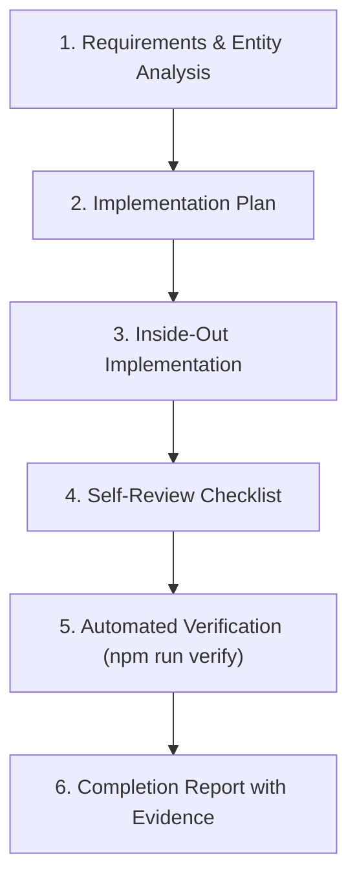

# Feature Development Skill

This skill defines the authoritative process and standards for developing new features or extending existing modules in the Student Management application using **Option B (Explicit Layering)**.

---

## 1. Core Principles

1. **Inside-Out Implementation**: Always implement layers from the bottom up:
   `Model ──> Service ──> Store ──> Facade ──> Component ──> Routes`.
2. **Strict Layer Boundary Isolation**:
   - Components MUST NOT import `services/` or `store/`. All interactions pass through `facades/`.
   - Facades coordinate state and actions; they NEVER inject `HttpClient`.
   - Stores manage state via NgRx SignalStore (`@ngrx/signals`); they call services for HTTP.
   - Services handle network transport via `HttpClient`; they have no dependencies on Store or UI.
3. **Automated Quality Gate Passing**: Every feature implementation must pass `npm run verify` (`check:arch` + `build` + `test:ci`) before completion.

---

## 2. The 6-Step Feature Workflow



### Step 1: Requirements & Entity Analysis
- Identify the domain entity, required fields, and unique identifiers (e.g., code, ID).
- Define relationships (e.g., student belong to class, teacher teaches subject).
- Identify validation constraints (e.g., scores 0–10, non-empty names, valid emails).
- Identify role-based permissions required for actions (`admin`, `teacher`, `student`).

### Step 2: Implementation Plan
- Enumerate files to create in `src/app/features/<feature>/`:
  - `models/<feature>.model.ts`
  - `services/<feature>.service.ts`
  - `store/<feature>.store.ts` (and unit tests)
  - `facades/<feature>.facade.ts`
  - `components/<feature>-list/` & `components/<feature>-detail/` (or form)
  - `<feature>.routes.ts`
- Determine mock API endpoints in `db.json`.

### Step 3: Inside-Out Implementation
Follow the strict sequence:
1. **Model**: Pure TypeScript interfaces and DTOs (`models/<feature>.model.ts`).
2. **Service**: HTTP communication with Angular `HttpClient` (`services/<feature>.service.ts`).
3. **Store**: SignalStore managing state, computed signals, and rxMethods (`store/<feature>.store.ts`).
4. **Facade**: Clean API exposing read-only signals and actions to UI (`facades/<feature>.facade.ts`).
5. **Component**: Reactive UI binding to Facade signals; styles importing `shared/styles/catalog.css`.
6. **Routes**: Feature routing setup (`<feature>.routes.ts`) and register lazy routes in `src/app/app.routes.ts`.

> See [feature-workflow.md](references/feature-workflow.md) for concrete code snippets for every layer.

### Step 4: Self-Review Checklist
Before running automated checks, verify:
- [ ] No component imports from `services/` or `store/`.
- [ ] No facade imports `HttpClient`.
- [ ] All forms use reactive forms with explicit validation.
- [ ] Diacritic-insensitive filtering (`toLocaleLowerCase('vi')`) is used for search where applicable.
- [ ] All components use `standalone: true` and reactive Signals.
- [ ] No `any` type annotations used.

### Step 5: Automated Verification
Run the complete validation pipeline:

```bash
# On Windows, run via cmd /c if executing from PowerShell:
cmd /c npm run verify
```

This verifies:
1. `npm run check:arch`: Validates layer boundaries and directory structure.
2. `npm run build`: Type-checks and builds application + SSR server.
3. `npm run test:ci`: Executes all Vitest unit test suites.

### Step 6: Completion Report with Evidence
Provide a clear summary including:
- Files created and modified.
- Output from `npm run verify` demonstrating zero errors and passing tests.
- Brief functional walkthrough.

---

## 3. Reference Files

- [feature-workflow.md](references/feature-workflow.md): Complete code templates and implementation examples for all 6 layers.
- Architecture standard: `.github/skills/project-architecture/references/architecture.md`.
- Coding conventions: `.github/skills/project-architecture/references/coding-conventions.md`.
