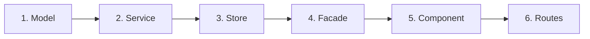

# Feature Workflow Reference - Student Management

This document provides the standard implementation sequence and code patterns for developing features under **Explicit Layering** in the Student Management project.

---

## 1. Implementation Order: Inside-Out

Always implement layers in the following order:



Developing from domain models upward prevents broken dependencies and ensures all business state is designed before writing UI templates.

---

## 2. Layer-by-Layer Implementation Patterns

### Step 1: Model (`models/<feature>.model.ts`)
Define TypeScript interfaces and DTOs.
```typescript
export interface Book {
  id: string;
  code?: string;
  title: string;
  category: string;
}

export type CreateBookDto = Book;
export type UpdateBookDto = Partial<Omit<Book, 'id'>>;
```

### Step 2: Service (`services/<feature>.service.ts`)
Pure HTTP client service using Angular `HttpClient`.
```typescript
import { Injectable, inject } from '@angular/core';
import { HttpClient } from '@angular/common/http';
import { Observable } from 'rxjs';
import type { Book, CreateBookDto, UpdateBookDto } from '../models/book.model';

@Injectable({ providedIn: 'root' })
export class BookService {
  private readonly http = inject(HttpClient);
  private readonly apiUrl = 'http://localhost:3001/books';

  getAll(): Observable<Book[]> {
    return this.http.get<Book[]>(this.apiUrl);
  }

  getById(id: string): Observable<Book> {
    return this.http.get<Book>(`${this.apiUrl}/${encodeURIComponent(id)}`);
  }

  create(data: CreateBookDto): Observable<Book> {
    const { id, ...payload } = data;
    return this.http.post<Book>(this.apiUrl, { ...payload, code: data.code ?? id });
  }

  update(id: string, data: UpdateBookDto): Observable<Book> {
    return this.http.put<Book>(`${this.apiUrl}/${encodeURIComponent(id)}`, data);
  }

  delete(id: string): Observable<void> {
    return this.http.delete<void>(`${this.apiUrl}/${encodeURIComponent(id)}`);
  }
}
```

### Step 3: Store (`store/<feature>.store.ts`)
State management using NgRx SignalStore (`@ngrx/signals`).
```typescript
import { computed, inject } from '@angular/core';
import { patchState, signalStore, withComputed, withMethods, withState } from '@ngrx/signals';
import { rxMethod } from '@ngrx/signals/rxjs-interop';
import { EMPTY, catchError, exhaustMap, finalize, pipe, switchMap, tap } from 'rxjs';
import { BookService } from '../services/book.service';
import type { Book } from '../models/book.model';

type BookState = {
  books: Book[];
  loading: boolean;
  errorMessage: string;
  successMessage: string;
  searchTerm: string;
};

const initialState: BookState = {
  books: [],
  loading: false,
  errorMessage: '',
  successMessage: '',
  searchTerm: '',
};

export const BookStore = signalStore(
  { providedIn: 'root' },
  withState(initialState),
  withComputed(({ books, searchTerm }) => ({
    bookCount: computed(() => books().length),
    filteredBooks: computed(() => {
      const q = searchTerm().trim().toLocaleLowerCase('vi');
      if (!q) return books();
      return books().filter(b => b.title.toLocaleLowerCase('vi').includes(q));
    }),
  })),
  withMethods((store, service = inject(BookService)) => {
    function load(): void {
      patchState(store, { loading: true, errorMessage: '' });
      service.getAll().subscribe({
        next: (books) => patchState(store, { books, loading: false }),
        error: () => patchState(store, { loading: false, errorMessage: 'Không thể tải dữ liệu.' }),
      });
    }

    return {
      loadBooks: () => load(),
      setSearchTerm: (searchTerm: string) => patchState(store, { searchTerm }),
      clearMessages: () => patchState(store, { errorMessage: '', successMessage: '' }),
      saveBook: rxMethod<{ item: Book; mode: 'add' | 'update' }>(
        pipe(
          tap(() => patchState(store, { loading: true, errorMessage: '', successMessage: '' })),
          exhaustMap(({ item, mode }) => {
            const req$ = mode === 'add' ? service.create(item) : service.update(item.id, item);
            return req$.pipe(
              switchMap(() => service.getAll()),
              tap((books) => patchState(store, { books, successMessage: 'Thành công.' })),
              catchError(() => {
                patchState(store, { errorMessage: 'Lỗi khi lưu.' });
                return EMPTY;
              }),
              finalize(() => patchState(store, { loading: false }))
            );
          })
        )
      ),
    };
  })
);
```

### Step 4: Facade (`facades/<feature>.facade.ts`)
Exposes reactive Signals and actions to UI.
```typescript
import { Injectable, inject } from '@angular/core';
import { BookStore } from '../store/book.store';
import type { Book } from '../models/book.model';

@Injectable({ providedIn: 'root' })
export class BookFacade {
  private readonly store = inject(BookStore);

  readonly books = this.store.books;
  readonly filteredBooks = this.store.filteredBooks;
  readonly bookCount = this.store.bookCount;
  readonly loading = this.store.loading;
  readonly errorMessage = this.store.errorMessage;
  readonly successMessage = this.store.successMessage;

  loadBooks(): void { this.store.loadBooks(); }
  setSearchTerm(term: string): void { this.store.setSearchTerm(term); }
  saveBook(item: Book, mode: 'add' | 'update'): void { this.store.saveBook({ item, mode }); }
  clearMessages(): void { this.store.clearMessages(); }
}
```

### Step 5: Component (`components/<feature>-list/<feature>-list.ts`)
Connects to Facade and AuthFacade. **Never imports Service or Store.**
```typescript
import { Component, inject, OnInit, signal } from '@angular/core';
import { ReactiveFormsModule, FormBuilder, Validators } from '@angular/forms';
import { RouterLink } from '@angular/router';
import { BookFacade } from '../../facades/book.facade';
import { AuthFacade } from '../../../../core/auth/facades/auth.facade';

@Component({
  selector: 'app-book-list',
  standalone: true,
  imports: [ReactiveFormsModule, RouterLink],
  templateUrl: './book-list.html',
  styleUrl: '../../../../shared/styles/catalog.css',
})
export class BookListComponent implements OnInit {
  readonly facade = inject(BookFacade);
  readonly authFacade = inject(AuthFacade);
  private readonly fb = inject(FormBuilder);

  readonly books = this.facade.filteredBooks;
  readonly loading = this.facade.loading;

  ngOnInit(): void {
    this.facade.loadBooks();
  }
}
```

### Step 6: Routes (`<feature>.routes.ts` & `app.routes.ts`)
Wire the new feature into the router with lazy loading:
```typescript
import { Routes } from '@angular/router';

export const BOOK_ROUTES: Routes = [
  {
    path: '',
    loadComponent: () => import('./components/book-list/book-list').then(m => m.BookListComponent),
  },
];
```
