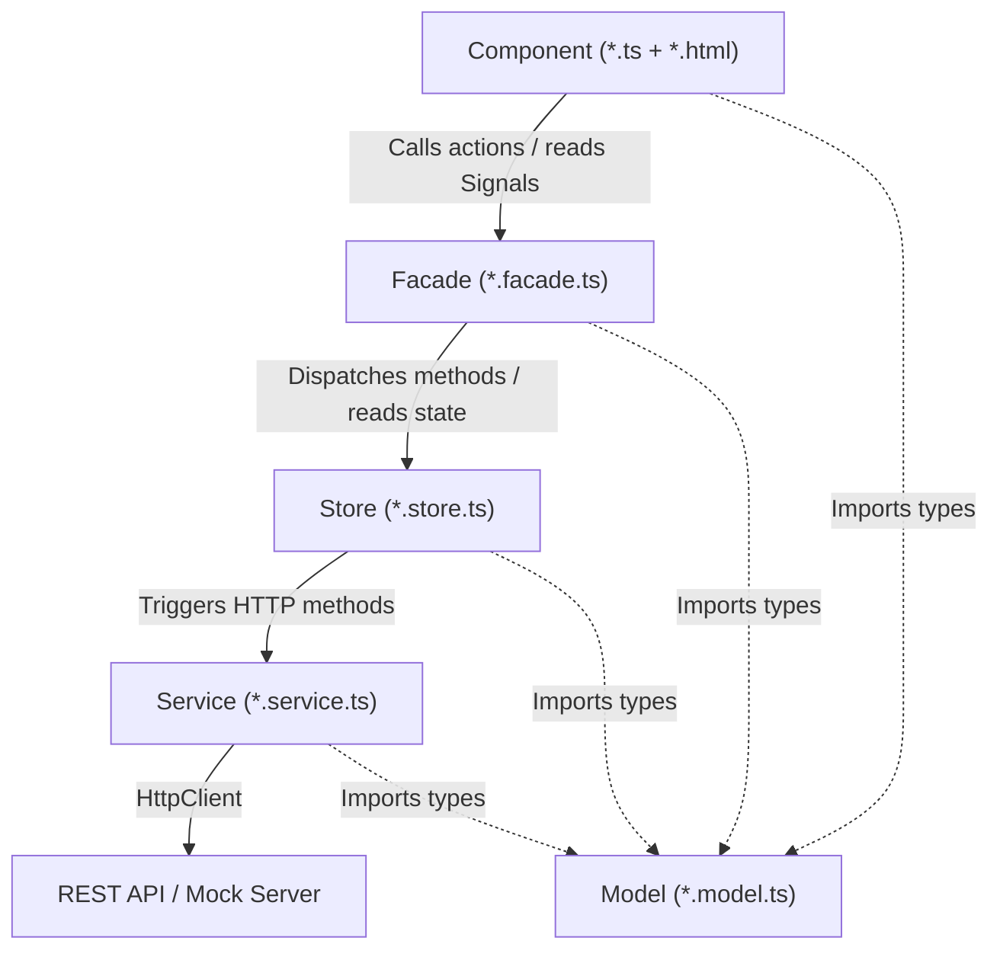
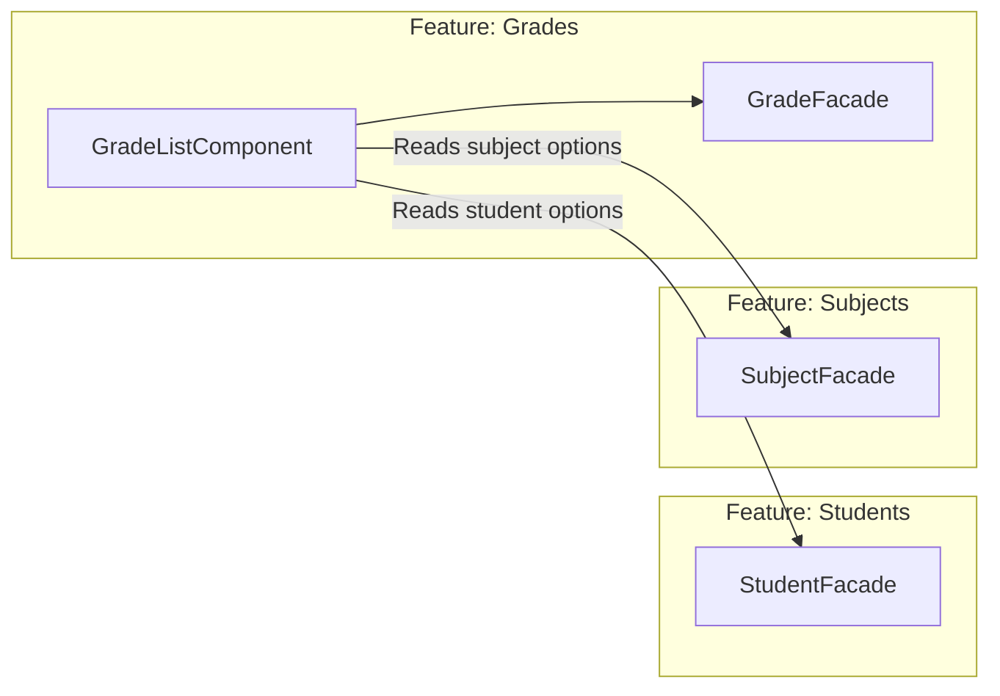

# Architecture Reference - Student Management

## Overview

The Student Management application is built on Angular 22 with Server-Side Rendering (SSR), NgRx SignalStore (`@ngrx/signals`), and Vitest.

The project strictly follows the **Option B (Explicit Layering)** architecture across all features:

```
Component ──> Facade ──> Store ──> Service ──> REST API
```

## Layer Responsibility Matrix

| Layer | Allowed Responsibilities | Forbidden Responsibilities |
| :--- | :--- | :--- |
| **Component** | • Render HTML template<br>• Capture user interactions<br>• Inject and consume Facades (read Signals, trigger Facade actions)<br>• Manage strictly local UI state (e.g. `showModal`, form open/close) | ❌ Direct HTTP calls (`HttpClient`)<br>❌ Direct injection of `services/`<br>❌ Direct injection of `store/`<br>❌ Complex business logic or validation algorithms |
| **Facade** | • Coordinate between Store and UI<br>• Expose Signals (state, computed filters, messages)<br>• Expose business actions (e.g., `saveStudent`, `deleteClass`)<br>• Coordinate cross-feature interactions (e.g. injecting another Feature's Facade) | ❌ Direct HTTP calls (`HttpClient`)<br>❌ Direct DOM manipulation or UI rendering |
| **Store** | • State management via NgRx `signalStore`<br>• Reactive state patching (`patchState`)<br>• Computed signals (`withComputed`) for filtering, sorting, pagination<br>• Async orchestration (`rxMethod`, `switchMap`, `exhaustMap`)<br>• Calls Services for network I/O | ❌ UI logic or HTML elements<br>❌ Direct manipulation of router or DOM |
| **Service** | • HTTP communication with REST API via `HttpClient`<br>• Request payload mapping and URL parameter encoding<br>• Returning typed Observables (`Observable<T>`) | ❌ Managing UI state<br>❌ Storing persistent state<br>❌ Dependency on Component, Facade, or Store |
| **Model** | • Interface definitions, DTO types, enums | ❌ Implementation logic or side-effects |
| **Shared** | • Reusable UI components, directives, pipes, shared CSS styles (`shared/styles/catalog.css`) | ❌ Business logic specific to a single domain feature |

## Data Flow & Dependency Direction



## Cross-Feature Communication

Features never access another feature's internal `Store` or `Service` directly from components. All cross-feature communication must happen through **Facades**:


