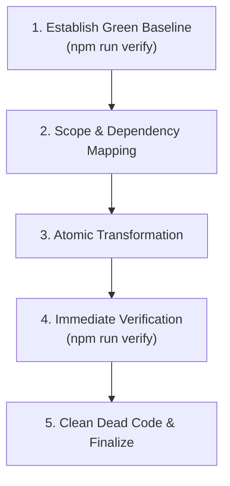

# Refactoring Skill — Student Management System

This skill guides safe, incremental refactoring of existing modules, services, and components in the Student Management project to conform to **Option B (Explicit Layering)** without introducing behavioral or build regressions.

---

## 1. Core Refactoring Principles

1. **Baseline Before Change**: Never start refactoring without first verifying that the current workspace builds and passes all tests (`npm run verify`). If the baseline is broken, fix that first.
2. **Atomic Increments**: Refactor one feature or one layer at a time. Do not attempt mass renames or multi-module restructuring in a single unverified step.
3. **Preserve External Contracts**: Changing internal layer organization (e.g. moving a service into `services/`) must not break the external behaviour expected by end-users or routing.
4. **Immediate Regression Verification**: Run `cmd /c npm run verify` immediately after each atomic transformation.

---

## 2. The 5-Step Safe Refactoring Workflow



### Step 1: Establish Green Baseline
Run the full verification pipeline before touching any code:
```bash
cmd /c npm run verify
```
Confirm:
- Architecture boundary checks pass: 0 violations.
- Application and SSR server build cleanly: 0 errors.
- Unit test suite passes: 100% passing tests.

### Step 2: Scope & Dependency Mapping
1. Identify the target module or layer to refactor.
2. Search all references and incoming imports using codebase search.
3. Prepare a target file transformation map (e.g. `data-access/` ➔ `models/`, `services/`, `store/`, `facades/`).

### Step 3: Atomic Transformation
1. Extract shared dependencies first (e.g., shared CSS, common interfaces).
2. Create or rename destination files to conform to Option B standards.
3. Update imports within the refactored module first.
4. Update external consumers (other features, router, specs).

### Step 4: Immediate Automated Verification
Re-run the verification pipeline right away:
```bash
cmd /c npm run verify
```
If errors arise:
- For architecture boundary errors: Inspect `scripts/check-architecture.mjs` output and decouple component-to-service links via Facades.
- For type/build errors: Check for broken import paths or missing exported interfaces.
- For test errors: Ensure mocked services match the updated method signatures.

### Step 5: Clean Dead Code & Finalize
- Delete obsolete directories (e.g., empty `data-access/`, retired monolith folders).
- Verify zero lingering unused files or dangling imports.
- Confirm final pass on `npm run verify`.

---

## 3. Safe Refactoring Checklist

- [ ] Baseline verified clean with `npm run verify` before starting.
- [ ] No direct component-to-service or component-to-store imports left behind.
- [ ] No `any` introduced during refactoring.
- [ ] Relative imports used consistently (`../../`).
- [ ] Unit tests updated with appropriate mock providers.
- [ ] `npm run check:arch` passes with 0 violations.
- [ ] `npm run build` succeeds without errors.
- [ ] `npm run test:ci` passes with 100% success.

---

## 4. References

- [refactoring-patterns.md](references/refactoring-patterns.md): Concrete refactoring patterns (deconstructing monoliths, decoupling components, replacing data-access, hardening test mocks).
- Architecture standard: `.github/skills/project-architecture/references/architecture.md`.
- Validation rules: `.github/skills/code-validation/references/validation-rules.md`.
