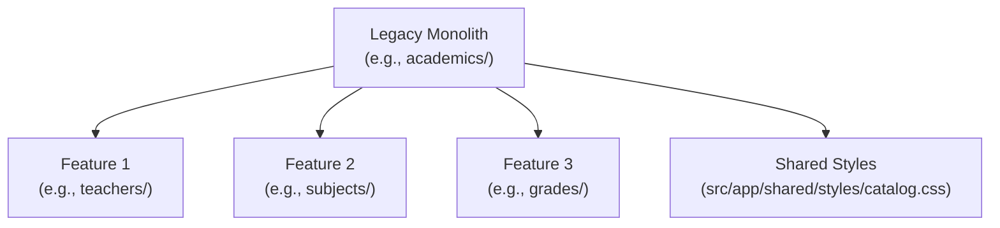

# Refactoring Patterns Reference - Student Management

This document catalogues safe, proven refactoring patterns established during the architectural standardization of the Student Management application under **Explicit Layering**.

---

## Pattern 1: Deconstructing Monolithic Feature Modules

When a feature module aggregates multiple unrelated domain entities (e.g. legacy `academics` containing teachers, subjects, grades):



### Steps:
1. **Extract Shared Assets First**:
   - Extract shared CSS (e.g. `catalog.css`) to `src/app/shared/styles/catalog.css`.
   - Update existing components to point to the shared style path.
2. **Create Independent Target Features**:
   - For each entity, generate the standard explicit layering structure: `models/`, `services/`, `store/`, `facades/`, `components/`, and `<feature>.routes.ts`.
3. **Migrate Logic & Wire Routes**:
   - Migrate domain interfaces, HTTP methods, and UI components into each independent feature folder.
   - Update `src/app/app.routes.ts` with top-level routes for each decoupled feature.
4. **Clean up Legacy Directory**:
   - Ensure zero remaining imports reference the legacy module.
   - Delete the legacy directory completely.

---

## Pattern 2: Decoupling Direct Service/Store from Components to Facades

Legacy components frequently inject `HttpClient`, `Service`, or `Store` directly.

### Before (Violation):
```typescript
@Component({...})
export class ClassDetailComponent implements OnInit {
  private readonly classService = inject(ClassService);
  private readonly studentService = inject(StudentService);
  classInfo: Class | null = null;
  students: Student[] = [];

  ngOnInit() {
    this.classService.getById(id).subscribe(c => this.classInfo = c);
    this.studentService.getAll().subscribe(s => this.students = s);
  }
}
```

### After (Compliant with Explicit Layering):
```typescript
@Component({...})
export class ClassDetailComponent implements OnInit {
  readonly classFacade = inject(ClassFacade);
  readonly studentFacade = inject(StudentFacade);

  // Derive reactive view state purely from facade signals
  readonly classInfo = computed(() =>
    this.classFacade.classes().find(c => c.id === this.classId() || c.code === this.classId()) ?? null
  );

  readonly classStudents = computed(() => {
    const info = this.classInfo();
    if (!info) return [];
    return this.studentFacade.students().filter(s => s.classId === info.id || s.className === info.name);
  });

  ngOnInit() {
    this.classFacade.loadClasses();
    this.studentFacade.loadStudents();
  }
}
```

### Key Benefits:
- 0 direct service or store dependencies in UI components.
- Automatic pass on `npm run check:arch`.
- Declarative, glitch-free UI updates via Angular Signals (`computed`).

---

## Pattern 3: Eliminating `data-access/` in Favor of Explicit Layers

Migrating from mixed `data-access/` folders into clean explicit layers:

### Transformation Map:
- `data-access/<feature>.model.ts` ➔ `models/<feature>.model.ts`
- `data-access/<feature>.ts` (Service) ➔ `services/<feature>.service.ts`
- `data-access/<feature>.store.ts` ➔ `store/<feature>.store.ts`
- `data-access/<feature>.facade.ts` ➔ `facades/<feature>.facade.ts`

### Rules:
1. Keep the Service name matching the convention: `<feature>.service.ts`.
2. Update all internal imports within the feature using relative paths (`../models/...`, `../services/...`).
3. Update all external consumer imports across other features and routes.
4. Remove the empty `data-access/` directory.

---

## Pattern 4: Hardening Unit Test Specs Against Mock API Failures

When running unit tests (`npm test` / Vitest), unmocked services cause `ECONNREFUSED` unhandled errors attempting to contact `localhost:3001`.

### Safe Mocking Pattern:
```typescript
TestBed.configureTestingModule({
  imports: [StudentListComponent],
  providers: [
    provideRouter([]),
    {
      provide: StudentService,
      useValue: {
        getAll: () => of([]),
        create: () => of({}),
        update: () => of({}),
        delete: () => of(undefined),
      },
    },
    {
      provide: ClassService,
      useValue: {
        getAll: () => of([]),
      },
    },
    {
      provide: AuthFacade,
      useValue: {
        can: () => true, // Ensure permission-gated buttons are visible in tests
        currentUser: signal({ id: '1', username: 'admin', role: 'admin' }),
      },
    },
  ],
});
```

---

## Pattern 5: Safe Removal of Obsolete / Dead Code

When retiring legacy files:
1. Perform global search for any import referencing the file.
2. Replace references with the new standardized paths.
3. Verify with `npm run check:arch`.
4. Delete the obsolete file.
5. Run full pipeline `npm run verify` to guarantee zero regressions.
