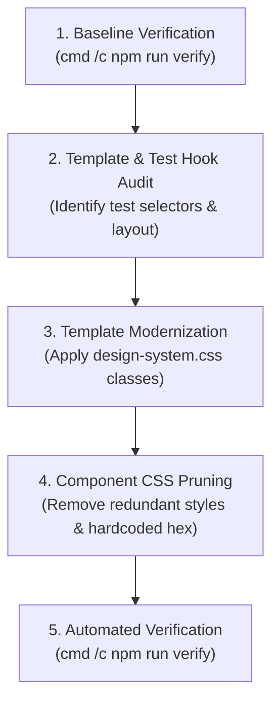

# UI Standardization Skill — Student Management System

This skill guides the systematic visual modernization and standardization of all UI screens in the Student Management project using the shared Design System (`src/styles.css` and `src/app/shared/styles/design-system.css`).

---

## 1. Core Principles

1. **Design Token Uniformity**: All colors, font sizes, margins, border radii, and shadows must derive from the CSS Variables defined in `src/styles.css`.
2. **Component Pattern Consistency**: Every screen must use the standardized structures from `design-system.css` (`.page-container`, `.page-header`, `.toolbar`, `.table-card`, `.data-table`, `.form-card`, `.badge`).
3. **Zero Test Regressions (Test Hook Preservation)**: Never remove CSS classes or selectors that are queried by Vitest unit tests (e.g., `button.primary-button`, `.search-box`, form inputs). Always include test-critical classes as secondary aliases if renaming.
4. **Strict Architecture Boundaries (Option B)**: UI changes must only touch templates (`.html`) and styles (`.css`). Components must continue to communicate **exclusively via Facades**.

---

## 2. The 5-Step Screen Standardization Protocol



### Step 1: Baseline Verification
Ensure the current workspace is green before touching any UI files:
```bash
cmd /c npm run verify
```

### Step 2: Template & Test Hook Audit
1. Inspect the target component template (`<component>.html`) and its spec file (`<component>.spec.ts`).
2. Identify test-critical selectors:
   - For example: `student-list.spec.ts` queries `button.primary-button`.
   - Ensure the new template retains `class="btn btn-primary primary-button"`.
3. Check permission guards: Ensure `@if (authFacade.can(...))` statements remain intact.

### Step 3: Template Modernization
Refactor HTML to follow the standard pattern:
- **Page Container**: Wrap the root in `<div class="page-container">`.
- **Header**: Use `<header class="page-header">` with `<h1>` and subtitle `<p>`.
- **Search & Filters**: Wrap in `<section class="toolbar">` with `.search-box` and `.filters`.
- **Table**: Wrap in `<div class="table-card">` with `<table class="data-table">`.
- **Buttons**: Use `.btn .btn-primary` (and `.primary-button` where required), `.btn .btn-secondary`, `.btn .btn-danger`.
- **Status Badges**: Use `<span class="badge badge-success">`, `badge-danger`, etc.
- **Empty States**: Use `<td colspan="..." class="empty">`.

### Step 4: Component CSS Pruning
1. In `<component>.ts`, verify the component style URL points to either the component CSS or shared CSS.
2. In `<component>.css`, delete redundant CSS rules that are already provided by `design-system.css` (e.g., generic table borders `#ddd`, hardcoded button colors, reset styles).
3. Retain only truly unique layout rules specific to that screen.

### Step 5: Automated Verification
Run the 3-in-1 verification pipeline:
```bash
cmd /c npm run verify
```
Confirm:
- Architecture boundary checks: **PASSED (0 violations)**.
- Build & SSR compilation: **PASSED (0 errors)**.
- Vitest unit tests: **100% PASSED**.

---

## 3. Screen Migration Checklist

- [ ] Page uses `var(--color-...)` tokens for any custom styling.
- [ ] Primary action buttons retain `.primary-button` class for spec compatibility.
- [ ] Tables use `.table-card` and `.data-table` with uppercase slate headers.
- [ ] Inputs have focus ring matching `--color-primary-100`.
- [ ] No direct Service or Store imports added.
- [ ] `cmd /c npm run verify` passes completely.

---

## 4. References

- Design Tokens Specification: [design-tokens.md](references/design-tokens.md)
- Standard Component Snippets: [component-patterns.md](references/component-patterns.md)
- Architecture boundaries: `.github/skills/project-architecture/SKILL.md`
